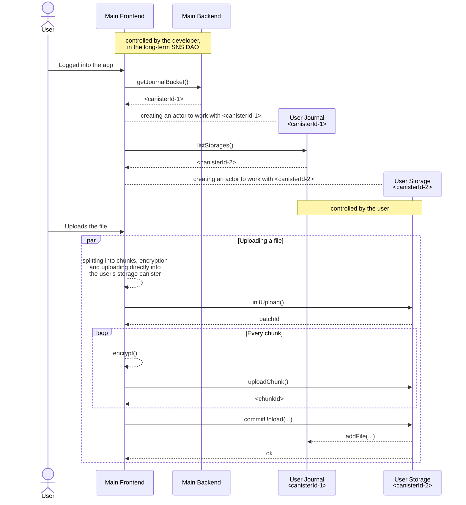
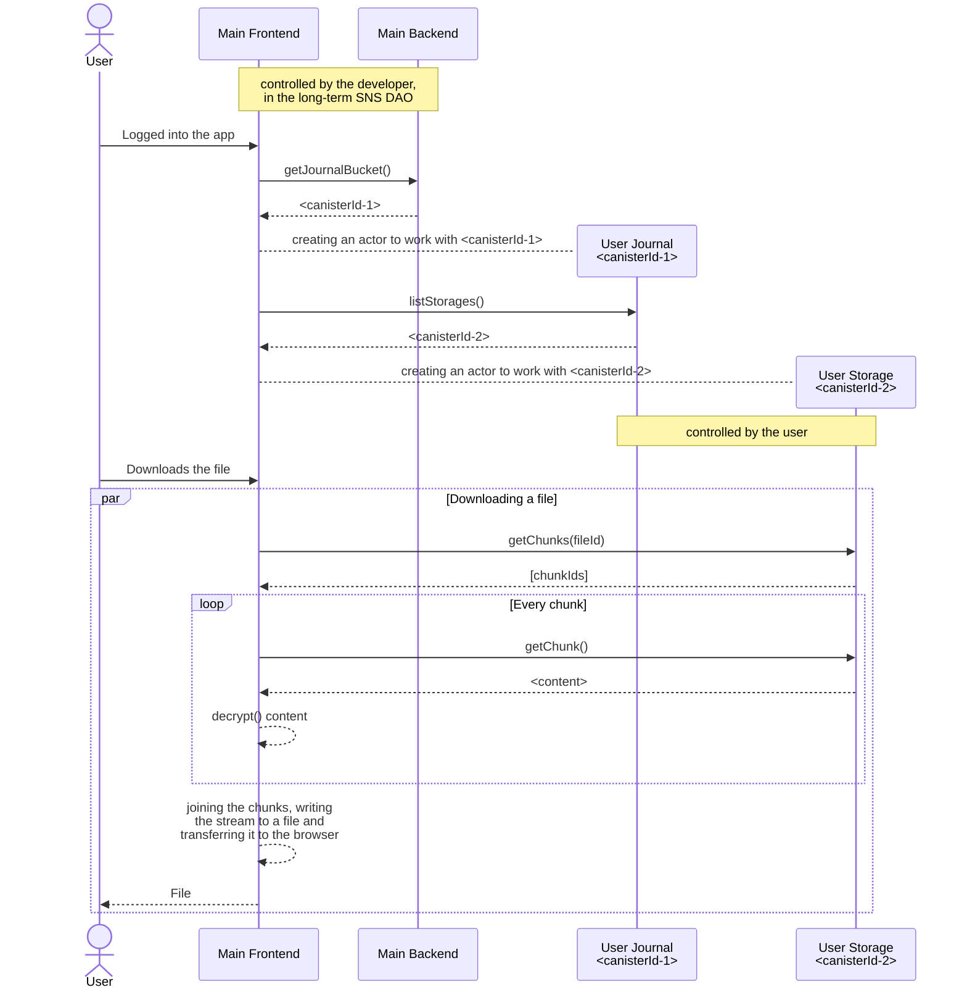
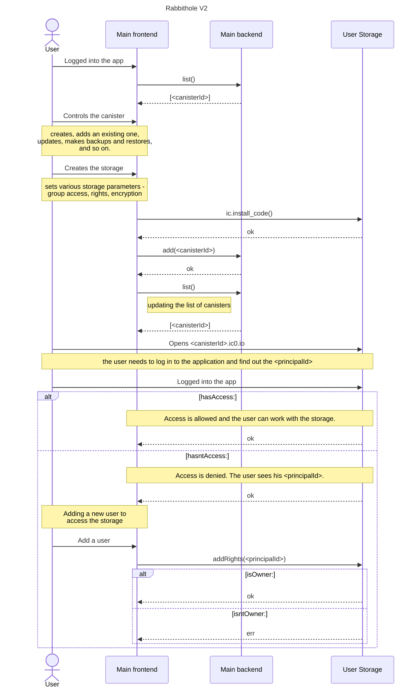
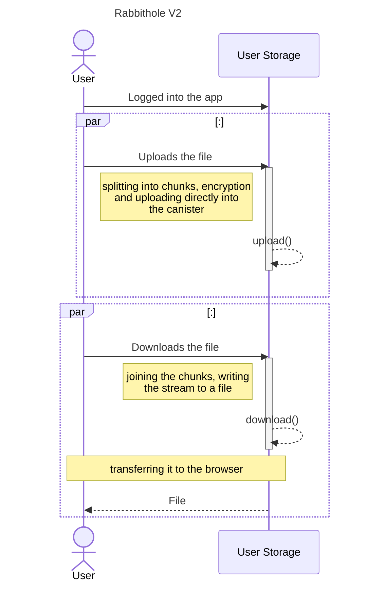

## Architecture

Below are diagrams illustrating the current implementation of file upload and download in the application.

### File Upload

### File Download

### Current Architecture Limitation

Although user-controlled canisters provide data ownership, the frontend remains a central point of failure. If the app’s controller disables the frontend or backend, the user might lose access to their own canisters and data.

## V2

### Storage Management

### Interaction Within a Single Canister

